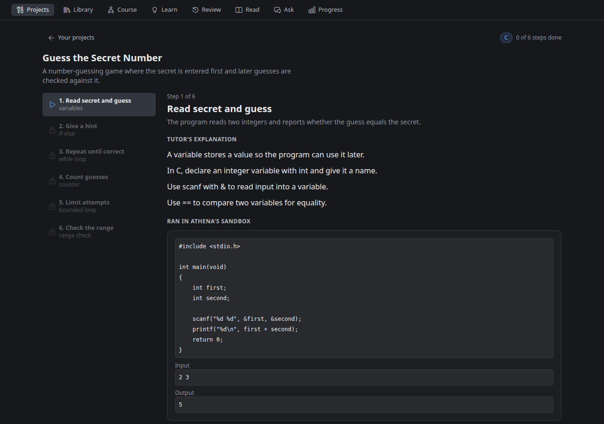
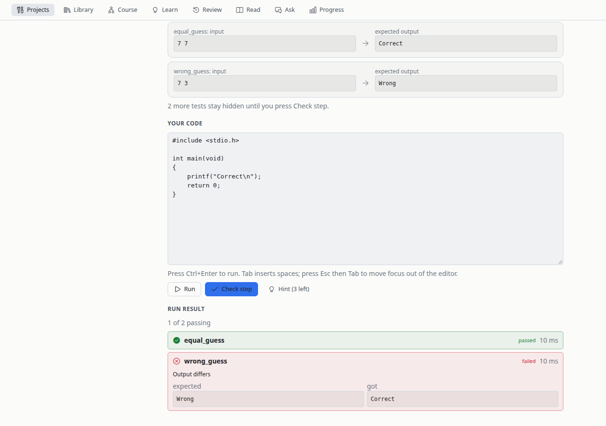

# CodeCoach

CodeCoach is a Hermes plugin that teaches you to code by building a real program, one small step at a time. Name a project ("a number-guessing game", "a word counter"), pick C or Python, and CodeCoach splits it into 4 to 8 build steps. Each step teaches one idea, shows a tiny example, and asks you to add it to your program. Your code is checked by actually compiling and running it against tests. At the end you have a whole working program that you wrote yourself.

It does not make things up where it matters:

- **Every example ran.** The output under an example is what the program really printed in CodeCoach's sandbox, not what a model said it would print.
- **Every pass is a real test.** Before you ever see a step, CodeCoach's own hidden solution must pass every one of that step's tests, and the previous step's solution must fail at least one of them, so each step really asks for something new.
- **Hints never contain the answer.** A hint, an example or a lesson sentence that carries a line of the step's solution is thrown out, whatever its spacing.



*Screenshots come from a real project planned and built by a model, rendered in a small test harness; they are not captures of the Hermes Desktop window.*

## How a project works

1. **Start.** Type an idea or pick one of the suggestions, choose C or Python. One model call plans the project into small steps. An idea that cannot run as a plain input-to-output program (a web browser, a game with graphics) is turned down with a reason.
2. **Learn the step.** A short explanation labelled *Tutor's explanation*, an example program labelled *Ran in CodeCoach's sandbox* with its real output, your task, and the visible tests (input and the exact output expected).
3. **Write the code** in the editor. It starts from your own program from the step before.
4. **Run** checks the visible tests and shows expected next to what your program printed, or the compiler's error. **Check step** also runs hidden tests. Pass, and the next step opens.
5. **Stuck?** Up to three hints, one at a time: a nudge, then which construct to use and why, then the shape with blanks. CodeCoach's own solution unlocks only after three checks that did not pass and every hint used, and the step is then marked *with help*.
6. **Done.** Download your program as a `.c` or `.py` file, with the list of ideas you used.

The next step is built in the background while you work on the current one, so after the first step you rarely wait.



## The checks every step must pass

A step is shown only after code (not a model) has checked all of this. A step that fails is rebuilt, at most twice, and then shown as *could not be built* with the plain reason and a Try again button.

| Check | What it guarantees |
|---|---|
| The solution passes | CodeCoach's hidden reference solution passes every visible and hidden test in the sandbox. |
| Something new | The previous step's solution fails at least one of this step's tests. |
| Same every time | The solution prints the same output on every run (no random values, times or memory addresses). |
| Real hidden tests | At least one visible and one hidden test; a hidden test never reuses a visible test's input. |
| Small steps | A step adds at most 40 lines to the program. |
| Real example output | The example compiles and runs; the output shown is the real one. An example that is really the answer is replaced or left out. |
| No answer in hints | Hints and lesson sentences that carry a line of the solution are dropped. |
| No surprise output | Every kind of line a hidden test expects has been shown to you in a visible test or quoted in the task, so you never have to guess exact wording. Programs print no input prompts. |

## Honest limits

- **Lesson text is the model's own words.** It is labelled *Tutor's explanation* and is not checked against a source. The examples, outputs and tests are checked; the prose is not. If you want explanations grounded in a book, use the notes features below.
- **Tests compare exact output** (trailing spaces ignored). The task quotes every line the tests check, but your program still has to print it as quoted.
- **C and Python only**, and only programs that read standard input and write standard output: no graphics, files, network or randomness.
- **The checks cannot judge teaching quality.** A step can pass every check and still teach its idea poorly or test it thinly. Use *Try again* on a step you don't like.
- **Local models are slow.** On a local 27B model, planning took 63 to 87 seconds and each step 65 to 190 seconds, so the first lesson appears 2 to 3 minutes after you press Start; later steps are built while you code.
- **Course rules come first.** If a course forbids AI help on its assignments (CS50 allows only its own Duck on problem sets), use CodeCoach for your own projects, not for those assignments. CodeCoach invents its own projects; it does not do problem sets.

## Also: study your programming notes

Import lecture notes, a book chapter or docs in the **Library**, and CodeCoach turns them into a course: **Learn** explains each topic in small steps, **Review** asks spaced questions and coding exercises, and **Ask** answers questions about your notes. These features run in strict mode: every fact they show is a word-for-word quote from your notes, checked by code, and Ask answers "Not in your materials" when your notes don't cover something. Imports are prepared by your model in the background, which takes a long time on a local model (an hour or more for a lecture's worth of notes). The known limits of the quote check are in [docs/REDTEAM.md](docs/REDTEAM.md).

## Install

You need Hermes 0.22.7 or newer.

```
hermes plugins install heyitstony97-max/codecoach
```

(Once CodeCoach is in the plugin catalog, `hermes plugins install codecoach` does the same.) Installing does not turn it on. There are two switches, and both start off:

1. **The Python half** (tools and the `/codecoach` command): run

   ```
   hermes plugins enable codecoach
   ```

   Enabling installs the one runtime dependency, `sympy` (pinned `>=1.12,<1.15`), through Hermes's dependency manager. Check with `hermes plugins list`.

2. **The desktop page**: in Hermes Desktop open **Capabilities -> Plugins** and switch CodeCoach on. The page appears in the sidebar as "CodeCoach". Its REST routes mount after a **gateway restart**, so restart the gateway once after enabling (the `restart` subcommand of `hermes gateway`).

**Running code needs** `bubblewrap` (`bwrap`) and, for C, `gcc`. Install both with your package manager and check them with `bwrap --version` and `gcc --version`. Without a working `bwrap`, CodeCoach refuses to run any code (it fails closed) and the Projects page says what to install.

**PDFs** (for the notes features) are read with `pdftotext` from `poppler-utils`.

**Validate the checkout** (what the catalog CI runs, minus the dependency install): `hermes plugins validate .`

### Route CodeCoach to a local model

By default CodeCoach uses your active Hermes model, which may be a cloud provider and may spend subscription allowance. CodeCoach registers its own auxiliary task, `codecoach`, so you can point only CodeCoach somewhere else, for example a local model you serve (llama.cpp or any OpenAI-compatible server):

```
hermes config set auxiliary.codecoach.provider custom
hermes config set auxiliary.codecoach.model <your-model-id>
```

`hermes config set` may print "not a recognized config key" for these; the values are still saved. For a custom endpoint also set `auxiliary.codecoach.base_url` (see the Hermes docs on auxiliary models). Raise the plugin setting `llm_timeout_s` (default 600 seconds per model call) and `auxiliary.codecoach.timeout` (Hermes's default is 90 seconds) for slow local models:

```
hermes config set plugins.entries.codecoach.settings.llm_timeout_s 1800
```

## Use it

**Desktop.** Open **CodeCoach** in the sidebar. **Projects** is the first tab: start a project, open any step you have reached from the step list, and come back later; your code and progress are saved. **Library**, **Learn**, **Review**, **Read**, **Ask** and **Progress** are the notes features.

**`/codecoach` command** (CLI, Telegram, Desktop chat) covers the notes features (`/codecoach import <path>`, `/codecoach next`, `/codecoach answer <text>`, `/codecoach hint`, `/codecoach progress`). Projects are desktop-only in this version.

## Disclosures

- **Runs code locally.** Your code, CodeCoach's examples and its reference solutions are compiled and run in a temporary directory inside a `bwrap` sandbox with no network, a timeout and memory and process limits.
- **Sends your project idea, your notes and your answers to your active Hermes model.** That model may be a cloud provider. Route CodeCoach to a local model (above) to keep it on your machine. In Projects, your code is run locally and never sent to the model: steps are built from CodeCoach's own solutions.
- **Read aloud uses your Hermes voice.** With a cloud voice (`edge`, OpenAI, ElevenLabs) the passage text is sent to that provider; choose a local provider to keep it on your machine.
- **Stores projects, courses and progress** in `<hermes home>/plugin-data/codecoach/` (a SQLite file, `codecoach.db`, and an `audio/` cache).
- **No telemetry.** CodeCoach makes no network calls of its own, needs no credentials and never reads `.env`, `auth.json` or other tools' tokens; all model access goes through Hermes.
- It reads only the file paths you give it to import. It registers seven tools and the `/codecoach` command and adds a page to Hermes Desktop. It runs no background services: builds run on background threads and stop with the Hermes process.

## Privacy

Your projects, code, notes and progress are stored only in the data directory above, on your machine. Deleting that directory deletes everything. The only data that leaves your machine is what your active (or CodeCoach-routed) model provider receives from the prompts CodeCoach sends it.

## Development

```
env -u PYTHONPATH .venv/bin/python -m pytest -q
```

The suite needs no network and no Hermes; the code checks run in the real `bwrap` sandbox where it is installed. The project engine's contract is in [docs/PROJECT-CONTRACT.md](docs/PROJECT-CONTRACT.md).

## Licenses and sources

CodeCoach is MIT licensed, see [LICENSE](LICENSE). The demo text in `demo/materials/history.md` is National Park Service article text, public domain in the United States (17 U.S.C. 105); sources and edits are listed in [demo/materials/SOURCE.md](demo/materials/SOURCE.md). `demo/materials/c-basics.md` is an original outline written for this repo. The icon font in the screenshot harness is the VS Code codicon font, with its own license file next to it.
