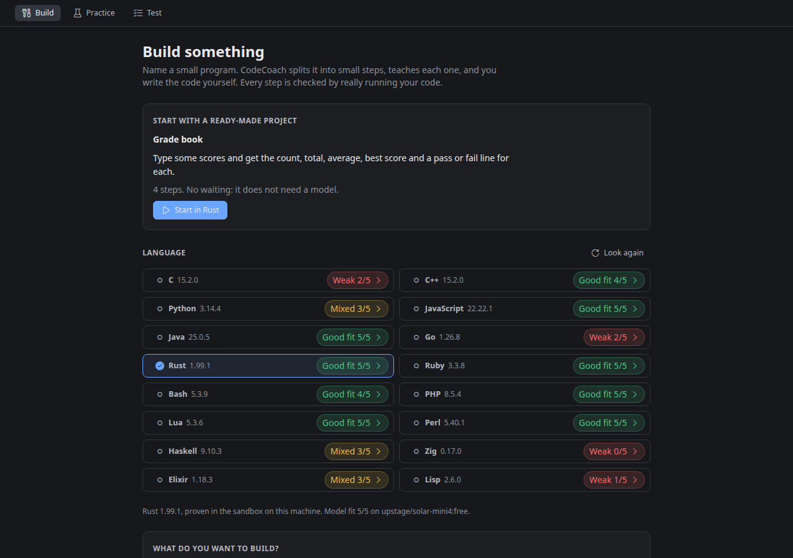
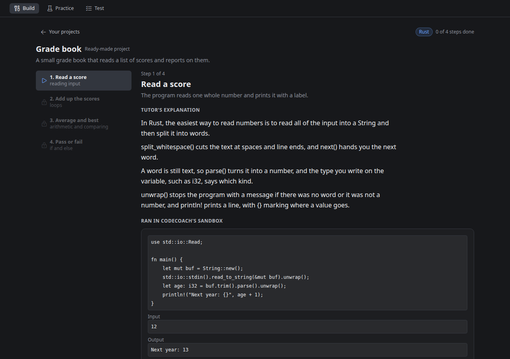
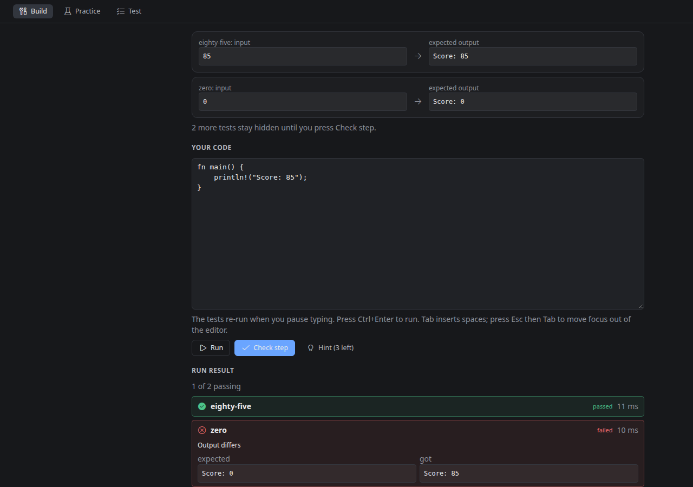
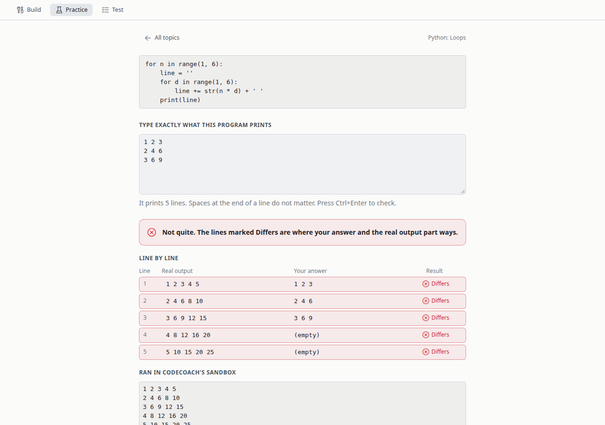

# CodeCoach

CodeCoach is a coding tutor that lives in Hermes. It teaches you to program in any of 16 languages your machine can run, in three ways: **Build** a real program one small step at a time, **Practice** by predicting what short programs print, and **Test** yourself with no hints and a score at the end.

Its one rule: nothing you are graded on is a model's opinion. Every example really ran. Every pass is a real test in a sandbox on your machine. The answer to "what does this print?" is what it printed.

**Try it in ten seconds.** Open CodeCoach, pick a language, and press Start on the ready-made *Grade book* project. It needs no model at all, so there is nothing to wait for: on the dev box the first lesson was on screen 0.6 seconds after Start in Python, 1.5 in Rust and 3.3 in Java.



*Screenshots show the real backend (real sandbox, real model) drawn in a small test harness; they are not captures of the Hermes Desktop window.*

## What you can do

**Build.** Start the ready-made project, or name your own ("a number-guessing game", "a word counter"). Your model plans it as 4 to 8 small steps; an idea that cannot run as a plain input-to-output program (a web browser, a game with graphics) is turned down with a reason. Each step teaches one idea, shows a tiny example with its real output, and asks you to add it to your own program. **Run** checks the visible tests and shows expected next to what your program printed, or the compiler's error. **Check step** also runs hidden tests. Stuck? Three hints, one at a time: a nudge, then which construct to use and why, then the shape with blanks. None of them contains the answer. CodeCoach's own solution unlocks only after three failed checks and every hint, and the step is then marked *with help*. At the end you download a whole working program that you wrote. The next step is built in the background while you work on the current one.

**Practice.** Pick a topic (variables, arithmetic, strings, if and else, loops, functions, lists and arrays, mixed tracing). CodeCoach shows a short program and you type exactly what it prints. The answer key is not the model's claim: it is what the program printed when CodeCoach ran it. You then see your lines next to the real ones and a short explanation.

**Test.** A checkpoint of 3 to 10 of those questions with no feedback until you finish. You can go back and change answers. Finishing gives a score, a breakdown by topic, your weak topics with a *Practice this* button each, and every question with the real output.







## Languages

A language is offered only after a small program in it was compiled and run **inside the sandbox on your machine** and printed the right line. Languages that are missing, or that fail that proof, are listed under *Not set up on this machine* with the reason. Press *Look again* after installing one.

| Language | Ready-made project | Start-up measured on the dev box |
|---|---|---|
| C, C++ | yes | 79 ms, 177 ms |
| Python | yes | 34 ms |
| JavaScript (Node) | yes | 183 ms |
| Java | yes | 306 ms |
| Go, Rust | yes | 127 ms, 79 ms |
| Ruby, Bash | yes | 85 ms, 17 ms |
| PHP, Lua, Perl | no | 36 ms, 17 ms, 18 ms |
| Haskell, Zig | no | 327 ms, 241 ms |
| Elixir, Lisp (SBCL) | no | 387 ms, 9 ms |

The first nine have the ready-made project and are tested end to end (create, every step through every check, finish). The other seven pass the same sandbox proofs (hello, input, a compile error in plain text, an endless loop stopped, a memory hog stopped, a fork bomb stopped, no network, no reading outside) and work for your own projects, Practice and Test, but they have had less end-to-end testing. See *Honest limits*.

## Is your model good at this language?

The model writes every lesson's hidden solution and every practice program. A model that is weak in a language builds lessons slowly there, or fails to build them. CodeCoach measures that instead of guessing:

- **Five fixed warm-ups per language** (add two numbers, count vowels, FizzBuzz, reverse the words, largest of a list). The model writes each one, and the sandbox runs it on three tests with hand-written answers. No retries: a retry would hide weakness.
- **A badge on every language:** *Good fit 5/5*, *Mixed 3/5*, *Weak 1/5* or *Not checked*. Open it for each warm-up's result, the model's name and when it was measured.
- **It runs on its own** the first time your model writes a lesson or a drill in a language, never ahead of your first lesson and never for the ready-made project. It costs five short model calls per language and model. Turn it off with the setting `auto_fit_check`.
- **A weak result is a warning, never a wall.** One line under Start says lessons may fail to build or take long, and the badge shows how to point CodeCoach at another model (Settings, Models, Auxiliary models, the CodeCoach tutor row; or two commands with copy buttons). Check again and the badge is measured for the new model.

**What that looks like on a real model.** One check per language with this version, on Nov 10, 2026, against `upstage/solar-mini4`, a small free cloud model, run through the repo's test harness (the badges in the screenshot above are this run):

| Verdict | Languages (warm-ups passed, of 5) |
|---|---|
| Good fit | JavaScript 5, Java 5, Rust 5, Ruby 5, PHP 5, Lua 5, Perl 5, C++ 4, Bash 4 |
| Mixed | Python 3, Haskell 3, Elixir 3 |
| Weak | C 2, Go 2, Lisp 1, Zig 0 |

Results move a little from run to run, because models do: another check of Python on the same model gave 4 of 5, and another of C gave 3. In the C and Python failures we read, the program came back without an `#include`, or with a stray closing brace after its last line. Slips like that also make a lesson fail to build, which is why the badge is worth a look before you start. And the model matters: the same C check on a second free model, `stepfun/step-3.7-flash`, gave 4 of 5.

## What is checked, and by what

Code, not a model, decides each of these. A lesson that fails a check is rebuilt, at most twice, and then shown as *could not be built* with the plain reason and a Try again button.

| Claim | How it is enforced |
|---|---|
| Every example ran | The example is compiled and run in the sandbox; the output shown is the captured output. An example that is really the answer is replaced or left out. |
| Every pass is a real test | CodeCoach's hidden solution must pass every visible and hidden test in the sandbox before you see the step, and the previous step's solution must fail at least one of them. |
| Same every time | The solution must print the same output on every run. |
| Hints never contain the answer | A hint, example or lesson sentence that carries a line of the step's solution is dropped, whatever its spacing. |
| No surprise output | Every kind of line a hidden test expects was shown in a visible test or quoted in the task. |
| A drill's answer is the real output | The program runs twice in the sandbox and must print the same 1 to 8 lines both times; that output is the key. |
| A drill does not give itself away | At least one output line must not be written out as a string in the code, and no comment may carry a line of the output. |
| No answer before you answer | What the screen receives before you answer holds no output and no explanation. During a Test it holds no right-or-wrong either, and your Practice scores do not move until you finish. |
| A language works here | Its hello-world was compiled and run in the sandbox on this machine. |
| The model's fit is measured | Five warm-ups, graded in the sandbox against hand-written answers. |

The same checks apply to the ready-made project: its lessons are shipped data, but they go through every check on your machine before you see them.

## Honest limits

- **Lesson text is the model's own words.** It is labelled *Tutor's explanation* and is not checked against a source. The examples, outputs, tests and answer keys are checked; the prose is not.
- **A drill's explanation can be wrong even when its answer key is right.** The key is what the program really printed. The explanation is the model's prose, written before the program ran. Reading 57 real drills from a small free model (`upstage/solar-mini4:free`) against their programs, 9 explanations said something false: 6 named a value the program did not print, and 3 were wrong in words. Since 1.1.1 an explanation that plainly contradicts the real output is left out, and the drill says so. That filter is not a proof: on 35 drills it had never seen, it caught 2 of the 4 wrong explanations (both that named a wrong value, neither that was wrong in words) and left out 1 of the 31 right ones. When the explanation and the real output disagree, the output is right.
- **The checks cannot judge teaching quality.** A step can pass every check and still teach its idea poorly. Use *Try again* on a step you don't like.
- **Tests compare exact output** (trailing spaces ignored). The task quotes every line the tests check, but your program still has to print it as quoted.
- **Plain input-to-output programs only:** no graphics, files, network or randomness.
- **PHP, Lua, Perl, Haskell, Zig, Elixir and Lisp are less tested.** They pass the sandbox proofs and the model check runs in all of them, but they have no ready-made project and the automated tests do not walk a whole project in them.
- **Models are weaker in less common languages.** That is what the fit badge is for. Expect more *could not be built* steps where the badge says Mixed or Weak.
- **Speed depends on your model.** Measured with this version: on a small free cloud model the first lesson of a model-planned project appeared 24 seconds after Start and a practice drill took 6 to 24 seconds; on a mid-size free cloud model the first lesson took 74 seconds. On a local 27B model, version 1.0 measured two to three minutes to the first lesson. Later steps are built while you code, and the ready-made project never waits on a model.
- **A Test that is still being written when Hermes restarts comes out shorter:** the questions not yet built are dropped.
- **Linux only**, because the sandbox is bubblewrap. On Linux older than 5.14 the sandbox's process limit is shared with everything else you run, so on a busy machine a correct program can occasionally fail to start; press Run again.
- **Course rules come first.** If a course forbids AI help on its assignments (CS50 allows only its own Duck on problem sets), use CodeCoach for your own projects, not for those assignments. CodeCoach invents its own projects; it does not do problem sets.

## Install

You need Hermes 0.22.7 or newer, on Linux.

**From Hermes Desktop (recommended).** Open **Capabilities -> Plugins**, choose **Install from Git** and enter `https://github.com/heyitstony97-max/codecoach` (or install `codecoach` from the plugin catalog). The dialog installs it and turns it on: both the tools and the desktop page. Restart the gateway once (`hermes gateway restart`) so the page's routes mount, and **CodeCoach** appears in the sidebar.

**From the command line.**

```
hermes plugins install heyitstony97-max/codecoach
hermes plugins enable codecoach
hermes gateway restart
```

Enabling installs the one runtime dependency, `sympy` (pinned `>=1.12,<1.15`), through Hermes's dependency manager. Check with `hermes plugins list`. Hermes keeps a plugin's desktop page off until you turn it on, and a command-line install doesn't do that. So also open **Capabilities -> Plugins** in Hermes Desktop and switch on the **Desktop** switch in CodeCoach's row. If CodeCoach still isn't in the sidebar, that switch is the one to check.

**Running code needs** `bubblewrap` (`bwrap`). Without a working `bwrap`, CodeCoach refuses to run any code (it fails closed) and the page says what to install. Each language needs its own compiler or interpreter. Install the ones you want with your package manager (on Ubuntu, for example: `gcc`, `g++`, `python3`, `nodejs`, `default-jdk`, `golang`, `rustc`, `ruby`, `php-cli`, `lua5.3`, `perl`, `ghc`, `elixir`, `sbcl`) and press *Look again*.

**Updating from 1.0.** Your projects and progress are kept. Restart the gateway once after updating; until then the page works in C and Python only and says so.

**Validate the checkout** (what the catalog CI runs, minus the dependency install): `hermes plugins validate .`

### Point CodeCoach at another model

By default CodeCoach uses your active Hermes model, which may be a cloud provider and may spend subscription allowance. CodeCoach registers its own auxiliary task, `codecoach`, so you can point only CodeCoach somewhere else: in Hermes Desktop under **Settings -> Models -> Auxiliary models**, in the **CodeCoach tutor** row, or from a terminal:

```
hermes config set auxiliary.codecoach.provider <provider>
hermes config set auxiliary.codecoach.model <model>
```

`hermes config set` may print "not a recognized config key" for these; the values are still saved. For a custom endpoint (a local llama.cpp or any OpenAI-compatible server) also set `auxiliary.codecoach.base_url` (see the Hermes docs on auxiliary models). Raise the plugin setting `llm_timeout_s` (default 600 seconds per model call) and `auxiliary.codecoach.timeout` (Hermes's default is 90 seconds) for slow local models:

```
hermes config set plugins.entries.codecoach.settings.llm_timeout_s 1800
```

### Settings

| Setting | Default | What it does |
|---|---|---|
| `auto_fit_check` | on | Measure the model in a language the first time it writes a lesson or drill there (five short model calls). Off: only when you press Check. |
| `show_notes` | off | Bring back the v1.0 screens that turn your own notes into a course. |
| `llm_timeout_s` | 600 | Seconds to wait for one model call. |
| `allow_unsandboxed_code` | off | Run code without the sandbox when bubblewrap is missing. Leave off. |

Set one with `hermes config set plugins.entries.codecoach.settings.<name> <value>` and restart the gateway.

### The v1.0 notes features

CodeCoach 1.0 could also turn your own lecture notes or a book chapter into a course (**Library**, **Learn**, **Review**, **Read**, **Ask**, **Progress**), where every fact shown is a word-for-word quote from your notes, checked by code. Version 1.1 is a coding tutor, so those screens are hidden; nothing was deleted and your courses are kept. Turn the setting `show_notes` on to bring them back. The `/codecoach` command (`/codecoach import <path>`, `next`, `answer <text>`, `hint`, `progress`) and the seven tools belong to these features. PDFs are read with `pdftotext` from `poppler-utils`. The known limits of the quote check are in [docs/REDTEAM.md](docs/REDTEAM.md).

## Disclosures

- **Runs code locally, in a sandbox.** Your code, CodeCoach's examples, its solutions and the model's warm-ups are compiled and run in a temporary directory inside `bwrap`: no network, a time limit, memory, file-size and process limits, and nothing of your home folder.
- **What the sandbox can read:** the system folders (`/usr` and a few files under `/etc`), read-only. A compiler installed outside `/usr` gets only its own folder, read-only (for example a rustup toolchain). CodeCoach refuses to share your home folder, any parent of it, or a folder that holds anything besides the toolchain; such a language is listed as not set up, with the reason. Java also reads its settings under `/etc/java-*`, and Haskell its package list in `/var/lib/ghc`. Go and Zig get one build-cache folder under CodeCoach's own data directory while compiling.
- **Sends your project idea to your model**, plus the fixed prompts for lessons, drills and warm-ups. That model may be a cloud provider. **In Build, Practice and Test your code and your answers are never sent to the model**: steps are built from CodeCoach's own solutions, and what you write only ever goes to the sandbox. With `show_notes` on, your notes and your answers about them also go to the model, and Read aloud sends passage text to your Hermes voice provider.
- **Makes model calls you did not press a button for:** the next step and one spare drill are built in the background, and the model check runs once per language and model (see the setting above).
- **Stores projects, drills, tests and progress** in `<hermes home>/plugin-data/codecoach/` (a SQLite file, `codecoach.db`, a `lang/` folder with what the language proofs found and the build caches, and an `audio/` cache when the notes features are on).
- **No telemetry.** CodeCoach makes no network calls of its own, needs no credentials and never reads `.env`, `auth.json` or other tools' tokens; all model access goes through Hermes.
- It registers seven tools and the `/codecoach` command and adds a page to Hermes Desktop. It runs no background services: builds run on background threads and stop with the Hermes process.

## Privacy

Your projects, code, answers and progress are stored only in the data directory above, on your machine. Deleting that directory deletes everything. The only data that leaves your machine is what your active (or CodeCoach-routed) model provider receives from the prompts CodeCoach sends it.

## Development

```
env -u PYTHONPATH .venv/bin/python -m pytest -q
```

1,812 tests on the dev box: 1,806 pass, and 6 are known holes in the notes features' quote check, kept as expected failures so they stay visible (they are listed in [docs/REDTEAM.md](docs/REDTEAM.md)). The suite needs no network, no model and no Hermes; the code checks run in the real `bwrap` sandbox where it is installed, and tests for a language that is not installed are skipped. Contracts: [docs/PROJECT-CONTRACT.md](docs/PROJECT-CONTRACT.md) (the step checks) and [docs/V11-CONTRACT.md](docs/V11-CONTRACT.md) (languages, model fit, Practice and Test).

## Licenses and sources

CodeCoach is MIT licensed, see [LICENSE](LICENSE). The demo text in `demo/materials/history.md` is National Park Service article text, public domain in the United States (17 U.S.C. 105); sources and edits are listed in [demo/materials/SOURCE.md](demo/materials/SOURCE.md). `demo/materials/c-basics.md` is an original outline written for this repo. The icon font in the screenshot harness is the VS Code codicon font, with its own license file next to it.
